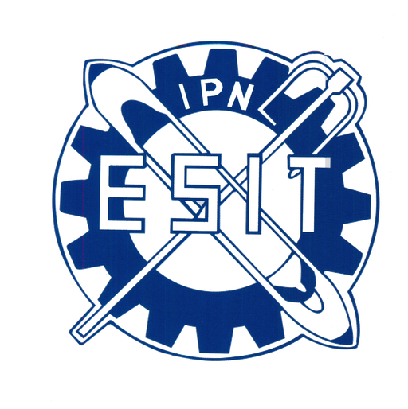

<div align="center">



# TextilSupply: innovación y logística inteligente

### Polilibro académico de **Logística y cadena de suministro**

**Instituto Politécnico Nacional · Escuela Superior de Ingeniería Textil (ESIT)**


</div>

---

## 📖 Acerca del proyecto

**TextilSupply** es un polilibro digital interactivo que acompaña a la unidad de aprendizaje
**Logística y cadena de suministro** de la carrera de **Ingeniería Textil** en la ESIT-IPN.

Su objetivo es que el estudiantado comprenda cómo se optimizan las fases de **abastecimiento,
almacenamiento, transporte y comercialización** que integran la cadena **fibra–textil–vestido**,
mediante contenidos teóricos, casos de estudio y simuladores interactivos bajo el enfoque de
*aprender haciendo*.

| Dato | Valor |
|---|---|
| Unidades temáticas | 5 |
| Temas | 25 |
| Casos de estudio (actividades finales) | 5 |
| Horas lectivas | 72 |
| Semestre | VIII |
| Modalidad | Presencial con apoyo del polilibro |

## 🧭 Contenido

| Unidad | Tema |
|:---:|---|
| **I** | Introducción a la logística y cadena de suministro |
| **II** | Almacenaje, señalización, codificación y tecnología de empaque |
| **III** | Cadenas de suministro en la industria textil y del vestido |
| **IV** | Transportación y régimen aduanero |
| **V** | Tecnología de la información y configuración de la red de distribución |

Cada unidad incluye temas, figuras y tablas, referencias bibliográficas y una
**actividad integradora** con simulador interactivo (EOQ/ROP, PEPS vs UEPS, matrices de
proveedores, Incoterms® 2020, ROI de RFID, redes omnicanal, entre otros).

## ✨ Características

- 📚 **Programa académico oficial** de la ESIT en un modal con descarga del PDF.
- 📝 **Examen diagnóstico** interactivo (los datos no salen del navegador).
- 🎮 **Simuladores y laboratorios** de toma de decisiones por unidad.
- 📖 **Glosario** de términos de logística textil.
- 👥 Sección de **autores y colaboradores**.
- 📱 Diseño adaptable a computadora, tableta y celular.

## 🗂️ Estructura del repositorio

```text
Libro-Log-Cad-Sum/
├── index.html            # Portada del polilibro
├── unidades.html         # Catálogo de unidades
├── 404.html              # Página de error
├── unidades/
│   └── unidad-0X/        # index, temas/, actividades/, referencias
├── assets/
│   ├── css/              # Estilos (variables, global, componentes)
│   ├── js/               # Lógica de navegación, modales y simuladores
│   ├── data/             # JSON: plan de estudios, glosario, examen, autores
│   ├── img/              # Emblemas e imágenes
│   └── docs/             # Documentos descargables
└── auditoria/            # Scripts y material de apoyo para la migración
```

## 🚀 Cómo usarlo

**En línea:** si GitHub Pages está activo, entra a
`https://isra921.github.io/Libro-Log-Cad-Sum/`.

**En tu computadora:** el sitio carga archivos JSON, así que conviene abrirlo con un servidor local:

```bash
git clone https://github.com/Isra921/Libro-Log-Cad-Sum.git
cd Libro-Log-Cad-Sum
python -m http.server 8000
```

Luego abre <http://localhost:8000> en tu navegador.

## 📄 Licencia

**TextilSupply: innovación y logística inteligente** © 2026, Escuela Superior de Ingeniería Textil (ESIT-IPN).
Distribuido bajo la licencia
[Creative Commons Atribución-NoComercial-SinDerivadas 4.0 Internacional (CC BY-NC-ND 4.0)](https://creativecommons.org/licenses/by-nc-nd/4.0/).

---

<div align="center">
<sub>Desarrollado como parte del Servicio Social · Instituto Politécnico Nacional</sub>
</div>
